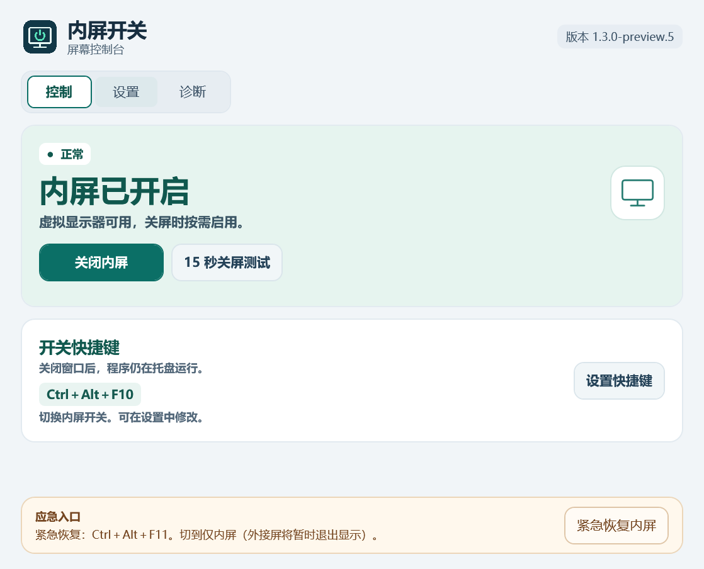

# 笔记本内屏开关


**让笔记本内屏像外接显示器一样独立开关。** 不用合盖，不让电脑睡眠；关掉内屏后，普通键鼠不会把内屏点亮，音乐、下载和其他后台任务可以继续运行。

**[下载完整版](https://github.com/mgm2545551249-code/notebook-panel-switch/releases/latest/download/PanelSwitch-win-x64.zip)** · **[下载轻量版](https://github.com/mgm2545551249-code/notebook-panel-switch/releases/latest/download/PanelSwitch-lite-win-x64.zip)** · **[查看最新版本与更新记录](https://github.com/mgm2545551249-code/notebook-panel-switch/releases/latest)**

适用于 **Windows 11 x64**；已实机验证 **联想拯救者 R7000P 2025 款（83LT）**。其他机型、电源键和显示驱动组合请先做十五秒关屏测试。



*控制页实图。截图来自 v1.3.0 发布前的界面预览，右上角保留预览版本号。*

## 第一次使用

| 下载项 | 适合谁 |
| --- | --- |
| [完整版压缩包](https://github.com/mgm2545551249-code/notebook-panel-switch/releases/latest/download/PanelSwitch-win-x64.zip) | **第一次使用优先选这个。** 包含 .NET 运行环境、安装和恢复入口，以及可选虚拟显示驱动。 |
| [轻量版压缩包](https://github.com/mgm2545551249-code/notebook-panel-switch/releases/latest/download/PanelSwitch-lite-win-x64.zip) | 已安装 **.NET 8 桌面运行时（x64）**，而且不需要本次安装虚拟显示驱动。轻量版与同版本完整版使用相同功能代码。 |

完整解压，运行 `PanelSwitch.exe`；先点「**15 秒关屏测试**」。只用笔记本内屏且尚无可用的虚拟显示驱动时，从完整版打开「**诊断 → 高级工具 → 检查／安装虚拟显示驱动**」。安装驱动需要管理员授权。不要在压缩包内直接运行。

| 操作 | 默认方式 |
| --- | --- |
| 日常开关内屏 | **Ctrl＋Alt＋F10**，也可点击控制页按钮。 |
| 紧急恢复内屏 | **Ctrl＋Alt＋F11**，也可点底部「紧急恢复内屏」。请求切回仅内屏，**外接屏会暂时停止显示**。 |
| 自定义快捷键 | 在「设置」中一起配置两组快捷键。 |
| 实体电源键 | 已适配机型可用短按切换；需要管理员代理，并应在目标机型上验证。 |

关闭窗口后仍在托盘运行；需要彻底退出时，从托盘选择「退出并恢复」。安装、开机启动和排查步骤见[使用说明](docs/使用说明.md)。

## 它和普通熄屏的区别

- **有物理外接屏：** 目标是只关闭笔记本内屏，保留外接屏和键鼠操作。
- **只有笔记本内屏：** 在可用的虚拟显示器承接桌面后，停用真实内屏的显示路径；普通键鼠输入不会因此重新点亮内屏。虚拟屏按需启用。
- 不使用黑色遮罩，不把亮度调到零，也不拦截普通键鼠。它切换的是 Windows 显示路径，不是已验证可适用于所有机器的面板硬件开关。
- 显示路径变化可能触发窗口重排、缩放变化或闪动。程序会尝试恢复布局，并可导出分辨率、缩放、工作区等参数用于排查；不同显卡、远控、游戏和桌面环境的效果需要分别验证。

## 兼容性与反馈

拯救者 R7000P 2025 款（83LT）的实机联调确认了日常快捷键、实体电源键关屏与恢复，以及普通输入不重新点亮内屏。实体电源键依赖可识别的系统按钮事件。Windows 10、ARM、其他机型、驱动首次安装和各类外接设备组合不视为已通过实机验证。详见[实机验证摘要](docs/实机验证摘要.md)。

- 问题反馈请前往[仓库问题区](https://github.com/mgm2545551249-code/notebook-panel-switch/issues)，说明机型、Windows 版本、软件版本、显示环境与复现步骤。
- 可在「诊断 → 高级工具」导出诊断；公开上传前请检查并遮盖本机路径、设备标识等信息。
- [轻量版使用说明](docs/轻量版使用说明.md) · [实现说明](docs/实现说明.md) · [第三方许可](docs/第三方许可)

## 从源码构建

需要 Windows 和 .NET 8 SDK。在仓库根目录运行：

```powershell
dotnet build ./src/PanelSwitch/PanelSwitch.csproj -c Release
dotnet run --project ./src/PanelSwitch/PanelSwitch.csproj -c Release
```

`scripts/发布.ps1` 生成包含运行环境的便携版（输出到 `artifacts/发行版`），加 `-IncludeVirtualDriver` 可附带驱动安装组件。用 PowerShell 7 运行 `scripts/发布轻量版.ps1` 可生成轻量包（输出到 `artifacts/轻量版`）。源码仓库不包含用户配置、凭据或本机原始日志。
